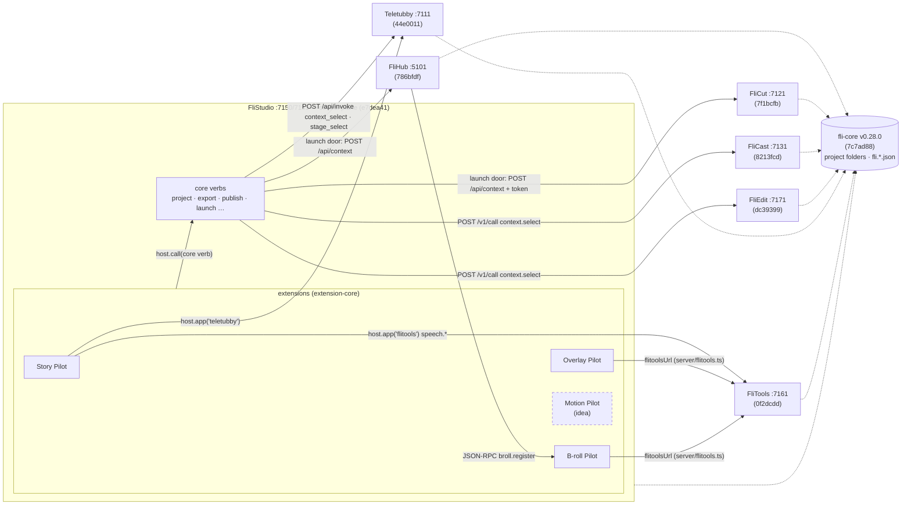

# 02 · FliVideo current state

**Purpose**: The verified lay of the land inside the FliVideo umbrella — what exists, where, at which commit, and
how the parts talk — so the potential target architecture (04) starts from fact, not from the conversation.

**For Agents**:
- **Only what exists is drawn here.** Proposed things (FliMotion, any candidate from 03b/candidates) never appear
  in this file. Motion Pilot appears once, marked `idea`, because David names it as one of the four extensions.
- Every row cites a repo path + 7-char SHA. Read on `mac-mini-m2` on 2026-11-03 ~12:00 +07, read-only: app repos
  were `git fetch`ed (remote-tracking refs only) and never pulled, built, run or edited.
- **Two M2 checkouts are behind origin.** `flistudio` local HEAD is `08a82b8` (2026-10-15), **133 commits behind**
  origin/main `e7dea41`; `flitools` local is `4fee551`, 6 behind origin `0f2dcdd`. The facts below are read from
  **origin/main** (via `git archive`), the code that runs on the M4. The M2 working copies were left alone.
- Statuses: **operational** (registered `active` in `~/.config/appydave/apps.json`, has a door, committed to in the
  last 10 days) · **partial** · **planned** (a repo or spec, no running code) · **idea** (named, no repo or module).
  "Operational" is from the registry and the code, **not** from running the app: nothing was launched.
- Sections: **Observed** (code/registry, cited) → **Inference** (mine, marked) → no recommendations (those are 03/04).

---

## 1. Inventory

### 1.1 The six apps

| App | Repo | SHA | Template | Ports (client/server) | Door (how an agent drives it) | OpenRPC methods | fli-core pin | Status |
|---|---|---|---|---|---|---|---|---|
| **FliStudio** | `/Users/davidcruwys/dev/ad/flivideo/flistudio` | `e7dea41` (origin; M2 HEAD `08a82b8`) | AppyStack 0.4.18 | 7150 / 7151 | JSON-RPC `POST /api/rpc` (bearer + port from `~/Library/Application Support/flistudio/control.json`); UI uses `/api/call`; `GET /api/capabilities`; CLI `bin/flistudio` | 172 (`api/openrpc.json`) | `v0.28.0` | operational |
| **FliHub** | `/Users/davidcruwys/dev/ad/flivideo/flihub` | `786bfdf` | none (predates AppyStack) | 5100 / 5101 | REST only — FliStudio opens it with `POST /api/context` on 5101, no token. **No JSON-RPC door of its own**; it is a *client* of FliStudio's (`server/src/utils/brollRegister.ts` → `broll.register`) | — | `v0.26.0` | operational |
| **FliCut** | `/Users/davidcruwys/dev/ad/flivideo/flicut` | `7f1bcfb` | AppyTron (Electron 34) | 5173 / 7121 | `POST /api/context` on its control port, bearer from `control.json`; CLI `bin/flicut` | 58 | `v0.28.0` | operational |
| **FliCast** | `/Users/davidcruwys/dev/ad/flivideo/flicast` | `8213fcd` | AppyTron (Electron 44) | 7130 / 7131 | `POST /v1/call { name, input }`, bearer from `control.json`; CLI `bin/flicast.mjs`; `bin/flicast-mcp.mjs` exists (implementation not read — UNVERIFIED whether it is a working MCP server) | 140 | `v0.26.0` | operational |
| **FliEdit** | `/Users/davidcruwys/dev/ad/flivideo/fliedit` | `dc39399` | AppyTron (Electron 44) | 7170 / 7171 | `POST /v1/call` (FliCast's door shape); CLI `bin/fliedit.mjs`; edit file `fli.edit.<name>.json` | 70 | `v0.26.0` | operational (built 2026-09-24; last commit "Drivable audit + layered-assembly spike") |
| **Teletubby** | `/Users/davidcruwys/dev/ad/flivideo/teletubby` | `44e0011` | AppyTron (Electron 34) | 7110 / 7111 | `POST /api/invoke { capability, input }`; CLI `bin/teletubby.mjs` | 37 | `v0.26.0` | operational |

Door shapes cited from `flistudio/server/src/launch/doors.ts` (origin `e7dea41`, lines 176–551); ports from
`~/.config/appydave/apps.json`; method counts = `jq '.methods|length' api/openrpc.json` per repo.

### 1.2 The extensions (inside FliStudio)

| Extension | Module | SHA | Namespace · stage | Calls other apps (`apps`) | Verbs: query / command | Source LOC (non-test) | Status |
|---|---|---|---|---|---|---|---|
| **Story Pilot** | `flistudio/modules/storypilot` | `e7dea41` | `story` · script | `teletubby`, `flitools` | 9 / 13 | ~8,000 | operational — **David testing today; not touched** |
| **Overlay Pilot** | `flistudio/modules/overlay-pilot` | `e7dea41` | `overlay` · overlay | — | 10 / 3 | ~5,300 (+ `render/render.py`, a Python renderer, + `grammar/`) | operational — **David testing today; not touched** |
| **B-roll Pilot** | `flistudio/modules/broll-pilot` | `e7dea41` | `broll` · record | — | 6 / 7 | ~4,200 (+ `taxonomy/`) | operational |
| **Motion Pilot** | none | — | — | — | — | — | **idea** — `/Users/davidcruwys/dev/ad/flivideo/docs/backlog.md:51` "Motion Pilot (planned, project d16)"; no module, no spec in FliStudio |

Verb counts: `grep -rhoE "kind: '(query|command)'"` over each module's non-test source (approximate: a verb defined
once is counted once; helpers that repeat the literal would inflate it — UNVERIFIED to the exact verb). LOC:
`wc -l` over non-test `*.ts*`.

### 1.3 Tools and foundations

| Part | Repo | SHA | What it is | Door | Status |
|---|---|---|---|---|---|
| **FliTools** | `/Users/davidcruwys/dev/ad/flivideo/flitools` | `0f2dcdd` (origin; M2 HEAD `4fee551`) | Shared service: transcription (Groq primary, mlx fallback), `audio.clean`, and since 2026-11-01 `speech.synthesize` (Kokoro), `face.track` (Joy's presenter tracker), `prompter.load` (Elgato Prompter) | HTTP on 7161; 21 OpenRPC methods (origin) | operational (M2 runs it as the transcription worker, LaunchDaemon) |
| **fli-core** (`@flivideo/core`) | `/Users/davidcruwys/dev/ad/flivideo/fli-core` | `7c7ad88` (v0.28.0) | Video-domain rules every app agrees on: brands, identity, layout, naming, paths, renders, publish, **the capability contract and the door** (`defineCapability`, control file, OpenRPC). Consumed by git tag | library | operational |
| **extension-core** (`@flivideo/extension-core`) | `flistudio/extension-core` | `e7dea41` | The extension contract: `defineExtension` descriptor, `ExtensionHost` (`call`, `app(name)`, `log`), `bindExtensions`, refusals | in-repo workspace | operational |
| `@appydave/core` | `/Users/davidcruwys/dev/ad/apps/appydave-foundation/packages/core` | not read | Process plumbing (lifecycle, config, logger, atomic write) used by the four AppyTron apps at `^0.2.0`; **FliStudio deliberately does not use it** | library | operational (per review 2026-10-29) |

**fli-core skew (observed):** FliStudio and FliCut pin `v0.28.0`; FliHub, FliCast, FliEdit, Teletubby and FliTools
pin `v0.26.0`.

### 1.4 Supporting and future (not among the six)

| Thing | Where | SHA | Status |
|---|---|---|---|
| **Snappy** (capture tool, per B687 §8.1 — supporting, not an extension) | `/Users/davidcruwys/dev/ad/apps/snappy` — **on the M4 only**, absent on M2 | `6ac748d` (M4, 2026-11-02, "empty repo — README pointing at spec") | planned |
| **FliTalent** | no repo found under `flivideo/` or `apps/` | — | idea — David: "that's for the future" (B686) |
| Other repos in the `flivideo/` folder, **not** part of the six | `flideck`, `fligen` (registry `inactive`); `storyline-app`, `flistack`, `flivoice`, `flilaunch`, `fli-brief` (registry `active`; flilaunch and fli-brief have no server) | not read | out of the six; listed so nobody counts them in |

---

## 2. Spike — how FliStudio loads its modules (B1 step 1)

**Question**: is "four extensions" true in code?

**Observed** (FliStudio origin `e7dea41`):
1. Each extension is an **npm workspace** listed in the root `package.json` `workspaces`: `extension-core`,
   `modules/overlay-pilot`, `modules/storypilot`, `modules/broll-pilot`.
2. Each has **three entries** (server / contracts / client), imported **statically by package name** in three host
   files: `server/src/extensions.ts` (`EXTENSION_SERVERS = [overlayPilot, storyPilot, brollPilot]`),
   `shared/src/extensions.ts` (descriptors), `client/src/extensions.ts` (screens).
3. `server/src/capabilities/registry.ts:332` binds them with `bindExtensions(EXTENSION_SERVERS, { reserved:
   hostNamespaces(), … })` — every extension verb runs through the same `callCapability` and ★ fence as a core verb,
   and appears in the 172-method OpenRPC.
4. `defineExtension` (`extension-core/src/descriptor.ts`) rejects a bad descriptor at definition time: kebab key,
   namespace prefix on every verb, and **`kind: 'query'` ⇔ `sideEffects: 'read-only'`**.
5. `.dependency-cruiser.cjs` (run by `npm run lint`) fences every `modules/<name>/`: FliStudio meets a module only
   at its declared entries; a module never imports FliStudio or another module; screens are browser-safe.
6. Cross-app calls (`host.app(name).call`, "G1") are **built and used**: Story Pilot calls `teletubby` and
   `flitools` (`modules/storypilot/server/index.ts:474`, `angles.ts:168`). The 2026-10-29 review §5.7 still says
   "design, not built"; that line is now stale.

**Answer**: **three extensions exist in code; the fourth (Motion Pilot) is an idea.** Loading is compile-time,
not a plugin system: adding an extension means a new workspace plus one line in each of the three host files.
No other FliVideo app hosts extensions.

---

## 3. How the parts talk

Solid arrows are calls seen in code; dotted arrows are shared files on disk via fli-core conventions.

**Observed rules of the road** (cited, not new):
- The app that owns a `fli.<app>….json` file is its only writer; others read it or ask the owner through its door
  (studio-pattern synthesis 2026-10-30 §1 row 5; FliStudio rule R4).
- Extensions reach FliStudio only through `host.call`, and other apps only through `host.app(name)` for apps listed
  in their descriptor's `apps`; anything else is refused `forbidden` (`extension-core/src/server.ts`).
- Overlay Pilot and B-roll Pilot get FliTools' URL from the host (`ExtensionHost.flitoolsUrl`; each has its own
  `server/flitools.ts`); Story Pilot reaches FliTools through `host.app('flitools')` instead. Overlay Pilot also
  shells out to its own Python renderer (`modules/overlay-pilot/render/render.py`).

## 4. Inference (marked — not observed)

- **Overlay Pilot is the extension that does capability work, not just workflow:** it owns a renderer and a
  grammar. That is the "fine line" David names in B686 (should overlays live in the pilot or in a FliMotion app?).
  03 picks this up; nothing is decided.
- **FliHub is the one app an agent cannot drive by JSON-RPC.** This matches the 2026-10-30 finding and is unchanged.
- **The extension count by verb kind** (query/command, §1.2) is the only measurable signal today for David's
  80-20 idea: Overlay Pilot ~77% queries, B-roll Pilot ~46%, Story Pilot ~41%. 03 uses it.

## 5. Not verified

- No app was run; "operational" means registered-active with a door and recent commits.
- `flicast-mcp.mjs` content; `@appydave/core` current SHA; Snappy's spec contents; whether the M4 checkouts match
  origin (they should; not checked).
- Exact verb counts (grep-based, see §1.2).

## Sources

- Repos as tabled (origin/main read via `git archive`, 2026-11-03).
- `~/.config/appydave/apps.json` (ports, status).
- `/Users/davidcruwys/dev/ad/flivideo/docs/architecture-review-2026-10-29.md` (four layers, extension-core design).
- `/Users/davidcruwys/dev/ad/brains/brand-dave/studio-pattern-synthesis-2026-10-30.md` (corrections table).
- B686 voice log, B687 dossier §8.1 (Snappy).
