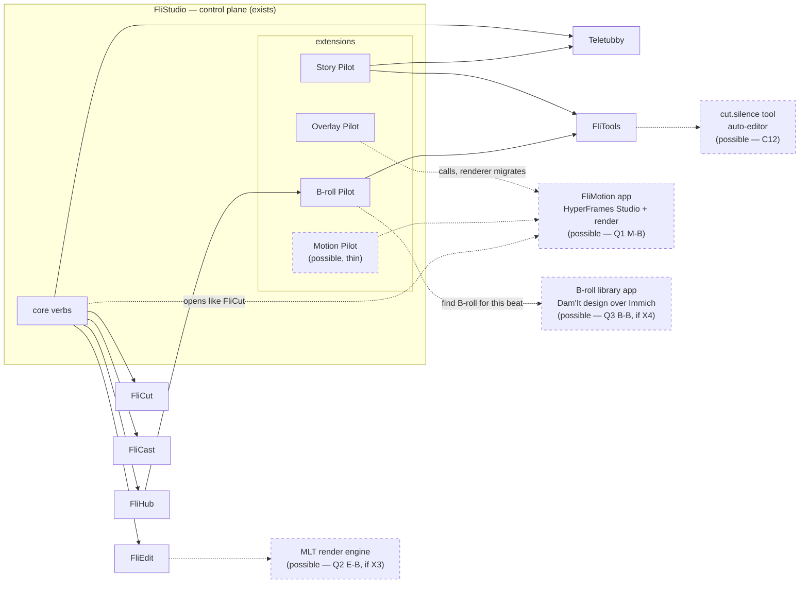

# 04 · Potential target architecture

> **POSSIBLE, NOT APPROVED.** This is a menu of options built from the research, not the future system
> (B687 §8.3, §11.4). Every lean below is a row in `06-approval-register.md`, where the default is
> *unapproved*. The current land is `02-flivideo-current-state.md`; nothing in 02 changes because of this file.

**Purpose**: For every candidate B2 researched, set out what FliVideo *could* do with it — the four outcomes David
named in B686 ("take the capabilities out of one app … add a new app … replace one of your apps", or nothing) —
with what each outcome depends on, so David can decide item by item.

**For Agents**:
- Inputs: `02` (current state, FliStudio origin `e7dea41`), `03` (taxonomy, 80-20, triggers T1–T5), `03b` + every
  `candidates/*.md` (B2, 2026-11-03). This file adds no new research; every fact is cited back to those files.
- Three kinds of statement, kept apart: **Observed** (from 02/candidates, cited) · **Inference** (B3's) ·
  **Lean** (B3's recommendation — not approved). Where B3's lean differs from B2's, both are shown.
- Outcomes are written for the *FliVideo* app that owns the concern today (03b column "owner").
- Do not build, clone or run anything from this file. Experiments that would settle a lean are in `05`.

---

## 1. The four outcomes

| Outcome | Meaning (B686) | Cost shape |
|---|---|---|
| **Absorb** | Take a capability (an engine, a library, an idea) *into an existing FliVideo app or tool*; the app keeps its name and door | lowest; our door, our UI |
| **Add** | Run the candidate (or a new app built on it) *alongside* our apps, reached through a door/adapter | medium; one more process, one more licence |
| **Replace** | Retire one of our six apps and use the candidate in its place | highest; migration of files + doors + habits |
| **None** | Note it, change nothing | zero; may revisit |

Licence gate (inference, from the candidate files): **AGPL** candidates (OpenMontage, Immich, Cap app, Recordly) are
safe to *run unmodified for ourselves* and to learn from; copying their code into FliVideo, or offering a modified
copy as a service, is where AGPL obligations start. **GPL** (Kdenlive, Shotcut, QPrompt, LosslessCut) blocks
*embedding their code*; running the binary is fine. **LGPL** (MLT, libopenshot) allows linking. MIT/Apache/Unlicense
(HyperFrames, Textream, auto-editor, video-use, Motion Canvas, Manim, Craft apps) carry no such gate. Not legal advice.

## 2. Per-candidate outcomes

Lean marked **★**. "Dep" = what the outcome depends on. Source file in brackets.

| # | Candidate (owner today) | Absorb | Add | Replace | None | Lean (not approved) |
|---|---|---|---|---|---|---|
| C1 | **HyperFrames Studio** (Overlay Pilot / FliEdit) [hyperframes-as-editor] | Use the HyperFrames engine + `check` gate under Overlay Pilot's overlays (already the direction of overlay work). Dep: none new | **★ Mount `EditorShell`/`Timeline` as a composition-editor surface in FliStudio, the way FliCut opens** — or as the core of a new *FliMotion* app (Q1). Dep: Q1; studio-server auth check (X2); adapter over REST/CLI (no JSON-RPC/MCP today) | Replace FliEdit with it. Dep: footage gap closed (multi-track A/V, ripple, audio mix — **UNVERIFIED**, X1) | Keep using it only as a renderer | **Add** (composition editor) + **absorb** (overlays). Replace FliEdit: only after X1 |
| C2 | **MLT** (+ Kdenlive as its GUI) (FliEdit) [fliedit-replacement §1] | **★ MLT as a headless render/assembly engine behind FliEdit's own edit file** (`melt` CLI, LGPL). Dep: an edit-file → MLT XML translator; native MLT install on M4/M2 (X3) | Run Kdenlive beside FliEdit for hand edits on exported MLT XML. Dep: XML round-trip stability (UNVERIFIED) | Replace FliEdit with Kdenlive. Not supported: no agent-drivable GUI | Keep FliEdit's own render path | **Absorb MLT** only if FliEdit's render path hurts (X3); Kdenlive **none** |
| C3 | **libopenshot** (FliEdit) [fliedit-replacement §2] | Python binding as an alternative render backend. Dep: JSON timeline API (UNVERIFIED, X9) | — (library; no app to add) | — (library, not an editor) | **★** | **None**; behind MLT if a backend is ever wanted |
| C4 | **Shotcut** (FliEdit) [fliedit-replacement §3] | — | Hand-edit GUI over MLT XML (same as Kdenlive) | Not supported (no agent surface found; not cloned) | **★** | **None** |
| C5 | **FilmCraft** (FliEdit / FliCut) [fliedit-replacement §4, craft-projects] | Borrow its JSON-control design. Dep: re-verify agent surface on M4 clone | Add once out of "in development". Dep: maturity | Replace FliEdit. Dep: maturity + verified surface | **★ watch** | **None now, watch** |
| C6 | **OpenMontage** (the pilots) [openmontage] | **★ Absorb the *pattern*: explicit stage graphs with per-stage revision caps and review gates into pilot design** (ideas only — AGPL) | Run it as an external pipeline. Dep: AGPL posture (R13), instruction-file trust, generative provider keys | Replace the pilots with its YAML pipelines. Loses human review UI + per-project state | Ignore | **Absorb ideas**; never depend on code |
| C7 | **Immich** (B-roll Pilot) [broll-dam §1] | — (a full server, not a library) | **★ Self-hosted B-roll library on the tailnet behind a FliVideo B-roll capability**, OpenAPI + scoped keys; B-roll Pilot stays per-project. Dep: typed per-media-type metadata (UNVERIFIED, X4); Docker + ML containers (breaks the "no Docker" default — David's call) | Replace B-roll Pilot. Wrong layer: Immich has albums, not projects | Keep B-roll on disk as today | **Add, conditional on X4**; else Dam'It design built own |
| C8 | **ResourceSpace** (B-roll Pilot) [broll-dam §2] | Borrow its per-resource-type field model for Dam'It | Self-host as the DAM. Dep: PHP+MySQL hardening | — | **★** | **None**; comparison point |
| C9 | **Dam'It** (own design, brain only) [broll-dam §3] | Its levels (project/brand/central/global) + R2 storage economics stay the *design owner* whichever store is used | **Build as a FliVideo app ("library-wide B-roll"), B-roll Pilot calls it.** Dep: Q3 | — | Leave as a brain | Design stands; build decision = Q3 |
| C10 | **Textream** (Teletubby) [teleprompter §1] | **★ Absorb the Director push-a-script + live word-progress ideas into Teletubby** (Story Pilot → Teletubby path already exists) | Add as a second prompter driven over its Director HTTP/WebSocket or `textream://`, e.g. as a FliTools `prompter.*` target beside Elgato. Dep: auth on port 7575 (UNVERIFIED, X5) | Replace Teletubby. Dep: Teletubby's features a subset of Textream's (not shown) | — | **Absorb ideas**; add only if X5 passes |
| C11 | **QPrompt** (Teletubby) [teleprompter §2] | — | Pro-hardware prompter. No agent surface found | — | **★** | **None** |
| C12 | **auto-editor** (FliCut) [flicut-alternative] | **★ Add as a FliTools-style tool (`cut.silence`-shaped verb) any app can call** — Unlicense, deterministic CLI | — | Not a FliCut replacement (silence only, no meaning) | — | **Absorb as a tool**, after X6 |
| C13 | **video-use** (FliCut) [flicut-alternative] | **★ Absorb meaning-based cut-pass ideas into FliCut** | Run beside FliCut as an agent-native cut proposer. Dep: X7 comparison | Replace FliCut. Not supported (FliCut has the UI and word-level model) | — | **Absorb ideas** after X7 |
| C14 | **LosslessCut** (FliCut) [flicut-alternative] | — | Manual lossless trims, run as is | — | **★** | **None** |
| C15 | **Cap** (FliCast) [screen-recording] | Borrow capture-crate (MIT) ideas | **Add for Loom-style quick capture** (not a switcher). Dep: none for running unmodified | Replace FliCast. Not supported (no Ecamm-style scenes) | **★** | **None** (B2: none/add) |
| C16 | **Recordly · open-recorder · Screenize** (FliCast) [screen-recording] | open-recorder's edit-document format; Screenize's event-log format, as references | — | — | **★** | **None**; format references. Never open open-recorder/Screenize as a workspace |
| C17 | **Craft projects** (ArtCraft's 7) [craft-projects] | JSON-control/MCP pattern | EffectCraft/LightCraft as overlay-adjacent engines once mature | — | **★ watch** | **None now, watch** |
| C18 | **Remotion** (Motion Pilot idea) [remotion] | Already owned; stays an engine option | Engine for a FliMotion app instead of HyperFrames (Q1) | — | — | **Absorb (keep)**; HyperFrames-vs-Remotion is part of Q1 |
| C19 | **Motion Canvas · Manim** (Motion Pilot idea) [motion-canvas] | — | Explainer-animation engine | — | **★** | **None**; HyperFrames/Remotion cover the lane |

**Where B3's lean differs from B2's** (inference): C1 — B2 lists *add* and *absorb* together; B3 puts **add** first
because David asked for it ("open like FliCut") and the spike found the components. C7 — B2 leans *absorb/add*;
B3 writes **add** because Immich is a full server, not a library, and makes it conditional on X4 and on David
accepting Docker.

## 3. Design questions (alternatives, not choices)

### Q1 — Motion: a Motion Pilot extension, or a FliMotion app? (ledger #13, 03 open (b))

**Observed**: Overlay Pilot already owns a renderer (`modules/overlay-pilot/render/render.py`) and a grammar — 03's
trigger **T5 holds, T1 is close**. Motion Pilot exists only as `docs/backlog.md:51`. HyperFrames Studio ships an
embeddable editor (C1).

| Design | Shape | Fits 03's rule? | Depends on |
|---|---|---|---|
| **M-A** Motion Pilot (extension) | A pilot holding motion briefs per video; calls HyperFrames/Remotion through FliTools or a door | Only if all rendering is delegated | someone owning the renderer (FliTools or an app) |
| **M-B ★** FliMotion (app) + thin Motion Pilot | New app owns the engine (HyperFrames Studio mounted, `check` gate, render); Overlay Pilot's renderer migrates into it over time; Motion Pilot and Overlay Pilot become workflows that call it | Yes — capability in an app, workflow in pilots | Q1 decision, X1/X2, R3 (does Overlay Pilot's renderer count as "an app inside a pilot") |
| **M-C** Status quo | Overlay Pilot keeps its renderer; no Motion Pilot yet | Breaks T5, knowingly | nothing |

**Lean (not approved)**: **M-B**, *later* — no extraction while David is testing Overlay Pilot; the first step is a
spec answering E4's question ("what does it borrow, what does it own?").

### Q2 — FliEdit's fate (ledger #15, #20)

**Observed**: no candidate is both a mature timeline editor and agent-drivable through a documented API
(fliedit-replacement roll-up). HyperFrames is the most drivable, but composition-first.

| Design | Shape | Depends on |
|---|---|---|
| **E-A ★** Keep FliEdit; HyperFrames for composition | FliEdit stays the footage assembler; HyperFrames (C1) is the composition/overlay editor. Two editors, two jobs | Clear seam: FliEdit hands an assembled cut to the composition layer (or the reverse) |
| **E-B** Keep FliEdit; MLT under it | Same UI and door; MLT renders | X3 |
| **E-C** Replace FliEdit with HyperFrames Studio | One editor for both | X1 passing on real footage |
| **E-D** Replace FliEdit with Kdenlive/Shotcut | GUI NLE over MLT XML | No agent surface — not supported |

**Lean (not approved)**: **E-A now, E-B if the render path hurts, E-C only after X1.** David's "deprecate our own
editor for someone else's" is not supported by today's evidence; it stays open.

### Q3 — B-roll: per-project pilot + library-wide store (ledger #21)

**Observed**: B-roll Pilot is per video project (FliHub registers takes via `broll.register`); the Dam'It brain
designs the library-wide levels and storage economics; FliHub's `b-roll/` is deprecated (broll-dam requirement).

| Design | Shape | Depends on |
|---|---|---|
| **B-A** Dam'It as a new FliVideo app, own store (R2) | B-roll Pilot calls it for "find B-roll for this beat" | build effort; Joy's B-roll tool redevelopment folds in |
| **B-B ★** Dam'It design over **Immich** storage/search | Immich holds files + tags + smart search; a thin FliVideo B-roll app/adapter enforces the levels and per-media-type tags | X4 (typed metadata), Docker accepted, AGPL run-unmodified posture |
| **B-C** ResourceSpace as the store | richer typed fields, heavier ops | PHP+MySQL hardening |
| **B-D** None | B-roll on disk per project, as now | — |

**Lean (not approved)**: **B-B if X4 passes, else B-A.** Either way B-roll Pilot stays the per-project workflow.

### Q4 — Teleprompter (ledger #17)

**Lean (not approved)**: keep Teletubby (operational, 37 OpenRPC methods, already called by Story Pilot); **absorb**
Textream's Director push + word-progress ideas; consider *adding* Textream as a second prompter target only after
X5. QPrompt: none.

### Q5 — Orchestration: are the pilots OpenMontage? (ledger #16, #42)

**Inference (B2, agreed)**: partly the same problem class — both are workflows an agent follows over capabilities.
Pilots add human review UI and per-project state; OpenMontage is agent-script YAML. **Lean (not approved)**: absorb
the stage-graph + revision-cap pattern into the pilot spec template (pairs with 03's E4); AGPL posture = learn, never
copy (R13).

## 4. A possible FliVideo land

Solid = exists today (02). **Dashed = possible, per the ★ leans above — not approved, not planned.** If every lean
were approved, this is the shape; each dashed node is a separate decision in 06.



Ideas absorbed with no new node (not drawn): Textream Director → Teletubby (Q4); video-use cut passes → FliCut
(C13); OpenMontage stage graphs → pilot specs (Q5).

## 5. Dependencies between decisions

```
R1 (80-20 = "writes delegate") ──► R3 (Overlay Pilot renderer counts) ──► Q1 FliMotion (R4)
                                                                            │
X1 HyperFrames footage test ──► Q2 FliEdit fate (R9) ◄── X3 MLT render ─────┘ (C1 add is shared by Q1 and Q2)
X4 Immich typed tags + Docker OK ──► Q3 B-roll store (R12)
X5 Textream port auth ──► Q4 add Textream (R15)
R13 AGPL posture ──► C6 OpenMontage, C7 Immich, C15 Cap
```

Inference: **R1 → R3 → Q1 is the critical path**; it is also the one that touches Overlay Pilot, which David is
testing today, so nothing on it should move until he is done testing.

## Sources

- `02-flivideo-current-state.md`, `03-apps-extensions-tools.md`, `03b-capability-landscape.md`, `candidates/*.md`
  (this folder, flivideo `6353e14` / `a435199`).
- Spike records: `/Users/davidcruwys/dev/ad/brains/north-star/deliver-2026-11-03-B686-flivideo-ecosystem-research.md` §7.
- B686 voice log; B687 dossier §8.3, §11.4.
