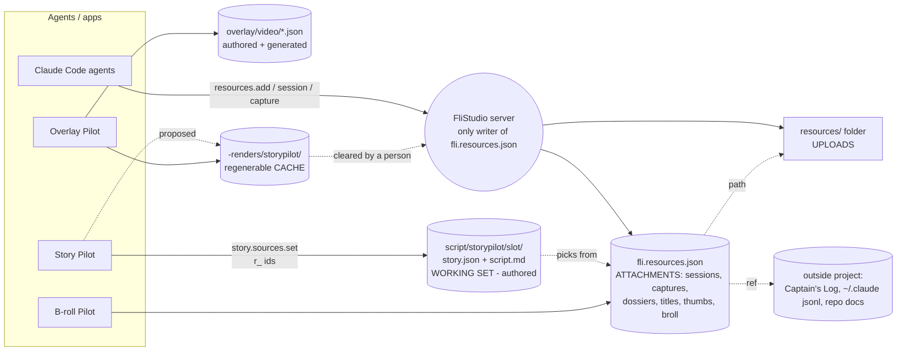

# FliStudio "resources" — what exists, why the menu says it twice, one model (2026-11-01)

Read-only audit. Nothing was changed. Brief: `docs/briefs/resources-model-audit-2026-11-01.md`.
Verified against D13 (`~/dev/video-projects/v-appydave/d13-overlay-pilot/`) and the code on `main` (`ccade17`).

## The short answer

- **Verdict: the data model is clearer than the menu.** The menu uses one word, "Resources", for two different things.
- `resources/` (folder, trailing slash) = **a folder on disk**. It is just a directory, shown because FliStudio lists every
  top-level folder it does not recognise. `Resources` (paperclip) = **records in `fli.resources.json`**.
  Those records are *references* to things (sessions, captures, notes) as often as they are files.
- The word is also overloaded *outside* the menu: Story Pilot's "sources", B-roll Pilot's pool, and fli-core's `audio`/`video`
  resource kinds all use "resource" or something that looks like it.

## Plain-language vocabulary used below

- **Zone** — FliStudio's name for a known top-level project folder (`recordings/`, `script/`, `videos/`…). fli-core maps folder name → zone → *tier* (`fli-core/src/classify.ts:36-60`).
- **Tier** — how precious a path is: `authored` / `input` (you can't regenerate it), `generated` (rebuildable from a recipe), `regenerable` (cache), `output` (a video). Test: "if you deleted it, could re-running a tool get it back?" (`classify.ts:136-139`).
- **Record** — a row in a JSON file. **Reference** — a record that points at something that lives elsewhere (a Captain's Log capture id, a Claude session id).

## 1. Inventory of resource-like stores

| # | Store | Where | Shape | Writes | Reads | UI calls it |
|---|---|---|---|---|---|---|
| 1 | `resources/` folder | `<project>/resources/<video-or-project>/…` e.g. `resources/project/storypilot-v2-reader-chin-bug.jpg` | plain files. **Not a zone** — absent from `ZONE_FOLDERS` (`classify.ts:51-62`), so it is an unclassified "other" folder | FliStudio `resources.add` copies files in (`server/src/capabilities/launch.test.ts` shows `resources/project/<file>`); path rule in `fli-core/src/resources.ts:96-97` ("project-relative `resources/…` when inside the project") | the Resources screen; Launch; Publish | rail: **`resources/`** (folder icon) |
| 2 | `fli.resources.json` | `<project>/fli.resources.json` (also `v-<brand>/` and `~/.config/appydave/` for the *registry* only) | `ResourcesFile` zod schema: `groups[]`, `kinds[]`, `off[]`, `resources[]`; each resource has `id r_…`, `kind`, `video` (null = project), `title/text/url/path/ref/meta`, `tags`, `audience`, `status` (candidate/in-test/chosen/published/retired), `added/changed` stamps (`fli-core/src/resources.ts:85-126`) | "FliStudio is the only writer" (`resources.ts:17`) — apps and agents go through its RPCs | Resources screen, Launch, Publish readiness, **Story Pilot** (sources), B-roll Pilot | rail: **`Resources`** (paperclip), count = records |
| 3 | Registry of kinds/groups | same file shape at global → brand → project; plus 3 `CORE_KINDS` in code: `video`, `audio`, `captions` (`resources.ts:195-229`) | data rows; "a new kind is a row — or nothing at all" (`resources.ts:19`) | FliStudio | Resources screen to draw values | group headings |
| 4 | Story Pilot working set | `<project>/script/storypilot/<slot>/{script.md,story.json}`; slot `project` in D13 | `story.json` schema `storypilot.story/1`: `settings`, **`sources[]` = ordered list of `{resource: r_id, label, role}`**, `script` (title, triggers per paragraph) (verified in D13) | Story Pilot server (`modules/storypilot/server/`), `story.sources.set`, door-log (`server/src/capabilities/door-log.ts:87`) | Story Pilot UI; `project-status.ts:352` (marks the project "scripted") | "Script", "sources" |
| 5 | `script/` folder | `<project>/script/` | zone `script`, tier **authored** (`classify.ts:243-247`) | Story Pilot / Teletubby | rail | rail: **`script/`** |
| 6 | B-roll Pilot | the D13 `broll` resource points at `resources/project/<jpg>` via `meta.broll`; the pool/taxonomy lives in `modules/broll-pilot/` | a resource of kind `broll` | B-roll Pilot module via FliStudio | its own screen | "B-roll" |
| 7 | Overlay Pilot | recipes `overlay/<video>/{beats,framing}.json` (authored), `spec.json` (generated); frames in `-renders/overlay-pilot/…` | files | Overlay Pilot module | itself | "Overlay" |
| 8 | `-renders/` | `<project>/-renders/<tool>/[<subject>/]` | cache, git-ignored (`fli-core/src/renders.ts:7-12`, `gitignore-rules.ts:79`) | any rendering tool via `rendersPath` | `renders.list` | size chip on project row |
| 9 | `-trash/` | `<project>/-trash/` | deleted takes / discarded cuts (`cut-discard.test.ts`: `-trash/2026-10-12-cut-xmen`) | FliHub, FliStudio | Trash review | Trash |
| 10 | Outside-the-project links | `fli.resources.json` records of kind `session` (`meta.transcript` = absolute `~/.claude/projects/…jsonl`), `capture` (`ref {schema:'captains-log', id:'B663'}`), `dossier` (absolute `path` into the flistudio repo) | **references only; nothing is copied** | agents, via RPC | Story Pilot | "Resources" rows |
| 11 | `fli.notes.jsonl`, `fli.tubby.json`, `fli.studio.json`, `hub/` | project root | notes / Teletubby / identity / FliHub dir | various | various | not resources — listed so nobody confuses them |
| 12 | fli-core `audio` resource kind | `CORE_KINDS` (`resources.ts:207-216`) | a *marker* on an exported video's audio (`meta.treatment`) | Publish | Publish | "Audio" (launch group) — **this is "the audio that ships", not narration** |

D13's `fli.resources.json` today (9 records): 3 `session`, 3 `capture`, 1 `dossier`, 1 `note`, 1 `broll`. Only the `broll` record has a file in `resources/`.

## 2. Why the menu says "Resources" twice

`client/src/screens/ProjectHome.tsx`:
- L779: every top-level folder not starting with `fli.` is turned into a menu row via `folderLabel` (L259: `footage` → "Footage", anything else → `` `${name}/` ``), count = number of *file groups the scanner found* (L793-800). `resources/` and `script/` get there because they are folders, so they appear as **`resources/ 0`** and **`script/ 0`**. The `0` is not "empty": the group scan counts recording-style groups, and `resources/project/x.jpg` isn't one. (I did not verify the scan internals beyond that; the screenshot's `0` with a real file present is consistent with it.)
- L815-822: a separate, hand-written row `Resources` with the paperclip, count = `resourcesSummary(resources).count` — records from `resources.list` (L291).

So two rows, one word, different data: **folder contents (never counted correctly) vs. records (what the Resources screen shows).** The same pair exists for `script/` — but there is no "Script" paperclip row because the script lives in Story Pilot's own screen.

## 3. The concrete case: Kokoro read of D13's script

Short form here; the full design is `docs/specs/storypilot-listen-2026-11-01.md`.

- **Not a resource, not a recording.** It is regenerable from `script.md` + a voice choice, so by the tier test it is cache.
- **On disk:** `-renders/storypilot/<slot>/audio/…` (see the listen spec). That is the existing cache home (`rendersPath({tool:'storypilot', subject:'project'})`, `renders.ts:34-44`), git-ignored, already shown with size and clearable.
- **Not** `resources/` (that would make it an attached thing a person curates, and Launch/Publish read that), **not** `voice/` (zone `voice` = "source recordings from FliCast, tier-1 input", `classify.ts:16-17`, a TTS file there would pose as a real recording), **not** `recordings/` (FliHub's take namespace), **not** `script/` (tier `authored`: it would be treated as irreplaceable and not cleaned).
- **How Story Pilot finds it:** by *derivation, not registration*: audio path = f(slot, paragraph hash, voice). Nothing written to `fli.resources.json`.
- **Distinct from a real recording:** different zone (`-renders`), tier `regenerable`, different tool segment, and filename carries the hash + voice.

## 4. Proposed model — three words

| Word | Means | Examples | Where |
|---|---|---|---|
| **Files** | things the project *owns* and can't regenerate | recordings, `script/`, `resources/` uploads, `videos/` | zones in `classify.ts` |
| **Attachments** | things attached *by record* to a video or the project, possibly by reference | sessions, captures, dossiers, titles, thumbnails, final-video marker | `fli.resources.json` |
| **Working sets** | an extension's own state, plus its regenerable cache | `script/storypilot/…`, `overlay/…`, `-renders/<tool>/` | per-extension; cache part = `-renders` |

Menu names (proposal):
- `Resources` (paperclip) → **"Attachments"**. It is what the data is; "resources" stays the *file name and API name* so nothing in `fli-core` changes.
- `resources/` (folder row) → **"Uploads"** (what `resources.add` puts there) and **hide the row when the folder is empty or fold it into Attachments**; alternatively drop it from the folder rows and show the files inside Attachments, where they are already referenced by `path`.
- `script/` stays but is named **"Script"** and counts story slots, not recording groups.
- Story Pilot "sources" → keep, but say "from Attachments" in its panel so it reads as picking from the list.

## 5. Ranked changes (smallest first)

1. **Rename the paperclip row to "Attachments"** (and its tooltip/summary chip, `ProjectHome.tsx:508`). FliStudio client only. Kills the double-"Resources" at once. Zero contract change.
2. **Stop showing `resources/` and `script/` as raw folder rows with a meaningless `0`**: either label them (Uploads / Script) with a file count, or hide them and let Attachments/Script own them. Client only (`ProjectHome.tsx:779-803`, `folderLabel` L259).
3. **Make `resources/` a known zone** (`ZONE_FOLDERS` in `fli-core/src/classify.ts:51`, tier `input`). **Touches shared `fli-core`** — a version bump and the pinned-package dance. Worth it only if (2) isn't enough; no UI change needs it.
4. **Decide the home for derived/cache working data of extensions**: `-renders/<tool>/` (already the rule, no change). Document it in the extension contract so the next extension doesn't invent `resources/audio/`.
5. **Rename in docs only**: "Attachments" for records, "Files" for owned, "Working set" for extension state; leave `RESOURCES_FILE`, `resources.*` RPC names alone (renaming them is a breaking contract change, high cost, no user benefit).

**Flagged fli-core touches:** only #3. Everything else is FliStudio client or docs.

## 6. Mermaid — who writes and reads what

## 7. What I could NOT verify

- Why the folder count is `0` for `resources/` (I did not trace the `scan.content.groups` producer; inferred from classifier + screenshot description).
- That `resources.add` is the only writer of `resources/` — saw it only through tests (`launch.test.js:786`).
- The screenshots in `/private/tmp/.../images/11.png`/`12.png`: not opened; the menu behaviour is from code at `ProjectHome.tsx`.
- Whether Teletubby (`fli.tubby.json`) or FliHub also write into `resources/`.
- B-roll Pilot's pool shape: I only read the D13 `broll` record, not `modules/broll-pilot/`.
